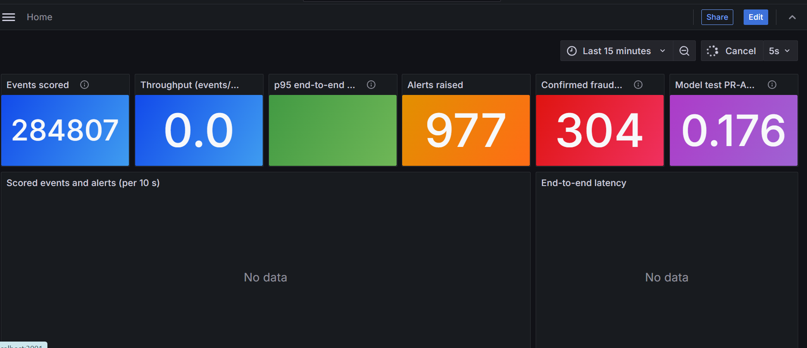

# Real-Time Fraud Detection System




[](https://github.com/Desmondonam/real-time-Fraud-detection/actions/workflows/ci.yml)

An end-to-end, real-time fraud detection pipeline. A Kafka producer replays credit card transactions as a live stream, a consumer scores every event with a hybrid rule engine + Isolation Forest model and writes results to PostgreSQL, Airflow retrains and promotes the model on a schedule, and Grafana shows the live picture. Everything starts with a single `docker compose up`.


<!-- Write-up: add the Medium article link here -->

---

## Table of Contents

- [What It Does](#what-it-does)
- [Architecture](#architecture)
- [Tech Stack](#tech-stack)
- [Project Structure](#project-structure)
- [Prerequisites](#prerequisites)
- [Quick Start (Docker Compose)](#quick-start-docker-compose)
- [Running Scripts Locally](#running-scripts-locally)
- [Tests](#tests)
- [How the System Works](#how-the-system-works)
  - [Stage 1 — Data Ingestion](#stage-1--data-ingestion)
  - [Stage 2 — Detection Logic](#stage-2--detection-logic)
  - [Stage 3 — Real-Time Scoring (Kafka)](#stage-3--real-time-scoring-kafka)
  - [Stage 4 — Retraining (Airflow)](#stage-4--retraining-airflow)
  - [Stage 5 — Dashboard (Grafana)](#stage-5--dashboard-grafana)
- [Model Performance](#model-performance)
- [Design Decisions and Trade-offs](#design-decisions-and-trade-offs)
- [Database Schema](#database-schema)
- [Script Reference](#script-reference)
- [Troubleshooting](#troubleshooting)

---

## What It Does

The system runs on the [Kaggle Credit Card Fraud Detection dataset](https://www.kaggle.com/datasets/mlg-ulb/creditcardfraud) (284,807 transactions over ~48 hours, 0.17% fraud).

1. **Ingests** the raw CSV into PostgreSQL (schema validation, null handling, `COPY` bulk load). This is the system of record and the source of the (delayed) fraud labels.
2. **Trains** a scorer with a **time-based split**: everything is learned on the earliest 60% of transactions, the alert threshold is tuned on the next 20%, and metrics are reported on the final 20%.
3. **Streams** transactions through **Kafka**: a producer replays the CSV in time order (60× real time by default) and a consumer scores **each event** as it arrives and writes the result to `scored_transactions`. On a laptop running Docker Desktop, end-to-end latency is p50 ≈ 100–200 ms and p95 ≈ 250–600 ms.
4. **Retrains** daily with **Airflow**. A candidate model is promoted only if its held-out PR-AUC passes a quality gate, and the consumer hot-reloads it without restarting.
5. **Visualises** throughput, latency, alerts, live precision and held-out metrics in **Grafana**, refreshing every 5 seconds.

---

## Architecture

```
                         creditcard.csv (DVC)
                       │                      │
          bootstrap job│                      │replayed in Time order
     (ingest + train,  │                      ▼
      runs once)       │          ┌──────────────────────┐
                       │          │  Kafka producer      │  no labels in events
                       │          └──────────┬───────────┘
                       │                     │ topic: transactions (3 partitions)
                       ▼                     ▼
┌──────────────────────────────┐  ┌──────────────────────────────────────┐
│ PostgreSQL                   │  │  Kafka consumer                      │
│                              │  │  micro-batch ≤500 msgs / 100 ms      │
│  transactions  (+ labels)    │◀─│  CombinedScorer → upsert → commit    │
│  scored_transactions         │  │  offsets (at-least-once, idempotent) │
│  model_metrics               │  │  hot-reloads the model bundle        │
│  fraud_alerts (view)         │  └──────────────────▲───────────────────┘
│  hourly_transaction_summary  │                     │ models volume
└───────┬───────────────▲──────┘                     │
        │ reads         │ metrics        ┌───────────┴──────────────────┐
        ▼               └────────────────│ Airflow: fraud_model_        │
┌──────────────────────────┐             │ retraining (@daily)          │
│ Grafana (localhost:3001) │             │ train → quality gate →       │
│ throughput · latency ·   │             │ promote                      │
│ alerts · live precision ·│             └──────────────────────────────┘
│ held-out metrics         │
└──────────────────────────┘
```

**Scoring model** (`src/detection/`):

```
rule_engine.py       Amount > 2σ / 3σ (train-window μ, σ)        +score
                     6 PCA rules learned on the train window    +score
                     Night (00-05) ×1.5 · Business (09-17) ×0.75
isolation_forest.py  V1-V28 + Amount + time_hour, contamination="auto"
scorer.py            combined = 0.4 × rule + 0.6 × IF
                     alert if combined ≥ threshold (tuned on the tune window)
```

---

## Tech Stack

| Layer | Technology |
|---|---|
| Language | Python 3.12 |
| Streaming | Apache Kafka 3.8 (KRaft, single node) + confluent-kafka |
| Database | PostgreSQL 16 |
| ML / Scoring | scikit-learn (IsolationForest, MinMaxScaler) |
| Orchestration | Apache Airflow 2.10 |
| Dashboard | Grafana OSS 11.4 |
| Runtime | Docker Compose |
| Data versioning | DVC 3.60 |
| Data access | pandas, SQLAlchemy, psycopg2 |

---

## Project Structure

```
real-time-Fraud-detection/
│
├── docker-compose.yml           # Whole stack: Postgres, Kafka, producer, consumer,
│                                #   bootstrap job, Airflow, Grafana
├── Dockerfile                   # App image (bootstrap, producer, consumer)
├── requirements.txt             # Pinned runtime dependencies
├── .env.example                 # Credentials template (copy to .env)
│
├── data/
│   └── creditcard.csv.dvc       # DVC pointer — actual file managed by DVC
│
├── src/
│   ├── ingest_and_clean.py      # Stage 1: CSV → PostgreSQL (COPY)
│   ├── train_detector.py        # Time-split training + held-out evaluation
│   ├── detection/
│   │   ├── rule_engine.py       # Rule scorer (rules learned on the train window)
│   │   ├── isolation_forest.py  # IF training + inference
│   │   └── scorer.py            # CombinedScorer, model bundle I/O
│   └── streaming/
│       ├── producer.py          # Replays the CSV into Kafka
│       └── consumer.py          # Scores each event, writes to Postgres
│
├── airflow/dags/
│   └── fraud_retraining_dag.py  # Daily retrain → quality gate → promote
│
├── docker/
│   ├── airflow/Dockerfile       # Airflow image + scikit-learn
│   └── postgres/01-create-databases.sql
│
├── grafana/provisioning/
│   ├── datasources/fraud_db.yaml      # Reads credentials from the container env
│   └── dashboards/
│       ├── dashboard.yaml
│       └── fraud_detection.json       # Auto-provisioned dashboard
│
├── scripts/
│   └── schema.sql               # Tables + views (idempotent)
│
├── tests/                       # pytest suite (no services needed)
├── .github/workflows/ci.yml     # CI: pytest, image builds, DAG import
├── docs/images/                 # README screenshots
│
└── models/                      # Model bundle when training on the host (gitignored)
```

---

## Prerequisites

| Requirement | Version | Notes |
|---|---|---|
| Docker Desktop / Docker Engine | Compose v2 | Runs the whole stack (~3 GB RAM) |
| DVC | 3.60+ | `pip install dvc`, to fetch `data/creditcard.csv` |
| Python | 3.12 | Only needed to run scripts or tests outside Docker |

---

## Quick Start (Docker Compose)

```bash
git clone https://github.com/Desmondonam/real-time-Fraud-detection.git
cd real-time-Fraud-detection

dvc pull                 # fetch data/creditcard.csv (see "DVC pull fails" below)
cp .env.example .env     # optional: set your own DB password
docker compose up -d --build
```

What happens:

1. **postgres** and **kafka** start.
2. **bootstrap** (one-shot) applies `scripts/schema.sql`, loads the CSV with `COPY`, trains the model with the time-based split and records its held-out metrics. Each step is skipped when its output already exists, so later `up`s are fast. Follow it with `docker compose logs -f bootstrap`.
3. **consumer** loads the model and subscribes to the `transactions` topic, then **producer** starts replaying.
4. **airflow** and **grafana** come up alongside.

| Service | URL | Login |
|---|---|---|
| Grafana | [http://localhost:3001](http://localhost:3001) | admin / admin |
| Airflow | [http://localhost:8080](http://localhost:8080) | admin / admin |
| Postgres | `localhost:5433` | values from `.env` (default postgres / postgres) |
| Kafka | `localhost:29092` | — |

Postgres is published on **5433** so it does not clash with a local install on 5432 (override with `POSTGRES_HOST_PORT`).

Replay speed and start point are configurable in `.env`:

```env
REPLAY_SPEEDUP=60          # dataset seconds per wall-clock second (0 = as fast as possible)
REPLAY_START_TIME=145248   # e.g. start at the held-out test window
```

Useful commands:

```bash
docker compose logs -f consumer         # scoring progress
docker compose up -d producer           # replay again (already-scored txns are skipped)
docker compose down                     # stop (data, model and offsets are kept in volumes)
docker compose down -v                  # stop and wipe all volumes
```

---

## Running Scripts Locally

Everything can also be run from the host against the compose services (`DB_HOST=localhost`, `DB_PORT=5433` in `.env`; Kafka on `localhost:29092`):

```bash
pip install -r requirements.txt
python src/ingest_and_clean.py                          # schema + COPY load
python src/train_detector.py                            # or: --csv data/creditcard.csv
python -m src.streaming.consumer                        # score events
python -m src.streaming.producer --speedup 600          # replay at 600×
```

`train_detector.py` prints metrics for every window:

```
================================================================
  DETECTION EVALUATION  (threshold = 0.4908, tuned on 'tune')
================================================================
  window     rows  fraud  ROC-AUC  PR-AUC   prec recall     F1
  fit     170,884    360   0.9558  0.5640  0.371  0.689  0.482
  tune     56,961     57   0.9421  0.0728  0.136  0.386  0.201
  test     56,962     75   0.9605  0.1756  0.231  0.453  0.306
```

The model bundle (IF model, learned rules, tuned threshold, split cut-offs and metrics) is saved to `models/fraud_scorer.pkl`, with the metrics also written to `models/metrics.json`. Inside Docker it lives in the `models` volume instead, so containers and host never mix scikit-learn versions.

---

## Tests

```bash
pip install -r requirements-dev.txt
pytest
```

The suite runs in about 15 seconds and needs no Postgres, Kafka or dataset. GitHub Actions (`.github/workflows/ci.yml`) runs it on every push and pull request. It also validates `docker-compose.yml`, builds the app and Airflow images, and checks that the DAG imports cleanly inside the Airflow image. It builds a small synthetic dataset shaped like `creditcard.csv`.

| File | Covers |
|---|---|
| `tests/test_rule_engine.py` | Amount σ-rules, `<` / `>` thresholds at their boundaries, time-of-day multipliers, normalisation to exactly 1.0, learned features/directions/thresholds, serialisation |
| `tests/test_scorer.py` | Weighted combination, threshold flagging, save/load round trip, `fit`/`tune`/`test` labelling, the time split, and a **leakage test**: flipping every label in the test window must not change the learned rules, threshold or IF scores |
| `tests/test_streaming.py` | Producer ordering, `txn_id` assignment, label-free payloads; consumer parsing of malformed messages, per-event row building, latency, and parity with batch scoring |

---

## How the System Works

### Stage 1 — Data Ingestion

**Script:** `src/ingest_and_clean.py`

1. **Schema** — applies `scripts/schema.sql` (tables, indexes, views; idempotent).
2. **Validation** — checks all 31 expected columns (`Time`, `V1`–`V28`, `Amount`, `Class`). Extra columns are dropped; missing columns raise an error.
3. **Null handling** — nulls in `V1`–`V28`, `Time` or `Amount` are filled with the column median; rows with a null `Class` are dropped.
4. **Bulk load** — assigns `txn_id` (the row's position in the CSV, which the producer also uses) and loads with `COPY`.

`Amount` is kept in raw currency units. `Time` is seconds since the first transaction (0–172,792, ≈ 48 hours).

### Stage 2 — Detection Logic

**Package:** `src/detection/`

Every transaction receives a rule score, an Isolation Forest score and a combined score.

#### Rule Engine (`rule_engine.py`)

A fast, interpretable scorer that applies threshold rules and returns a value in [0, 1]. Its parameters are **learned from the training window only** (`RuleEngine.fit`):

| Signal | Condition | Points |
|---|---|---|
| Amount spike | `|Amount − μ| > 2σ` (μ, σ from training window) | +1.0 |
| Extreme amount | `|Amount − μ| > 3σ` | +0.5 extra |
| PCA rule 1–6 | value beyond the 1% tail of *legitimate* training rows | +1.5, +1.0, +0.75, +0.5, +0.5, +0.25 |

The six PCA features are chosen by ranking V1–V28 on how far the fraud median sits from the legitimate median (in units of the legitimate IQR) on the training window. On the current split this picks V17, V14, V12, V10, V16 and V3, all in the "<" direction.

> Earlier versions hard-coded `V14 < −5`, `V17 < −5`, `V12 < −4`, … from published EDA on the *whole* dataset. Those thresholds had already seen the test labels, so they were replaced by the fitted rules above.

After summing points, a **time-of-day multiplier** is applied:

| Hour window | Multiplier | Rationale |
|---|---|---|
| 00:00 – 05:59 (night) | ×1.5 | Lower human oversight |
| 09:00 – 17:59 (business) | ×0.75 | Normal activity expected |
| All other hours | ×1.0 | Neutral |

The total is divided by the theoretical maximum (all points × 1.5) to produce a normalised score in [0, 1].

#### Isolation Forest (`isolation_forest.py`)

An unsupervised anomaly detector trained on the training window (first 60% of transactions by time).

| Parameter | Value | Reason |
|---|---|---|
| `n_estimators` | 200 | More trees → more stable scores |
| `contamination` | `"auto"` | Not set from the fraud rate (that would leak labels); the offset it controls is cancelled by the [0, 1] rescaling anyway |
| `max_samples` | `'auto'` | min(256, n_samples) sub-samples per tree |
| Features | V1–V28 + Amount + `time_hour` | 30 features total |

`time_hour` is `int((Time % 86400) / 3600)`, the hour of day assuming the dataset starts at midnight. The `Class` label is never shown to the model. `decision_function()` is inverted (more anomalous → higher) and scaled to [0, 1] with a `MinMaxScaler` fitted on the training window.

#### Combined Scorer (`scorer.py`)

```
combined_score = 0.4 × rule_score + 0.6 × if_score
```

The Isolation Forest gets more weight because it captures multivariate anomalies that single-feature rules miss. The rule engine keeps clear-cut violations visible even when the IF disagrees.

A transaction is **high-risk** when `combined_score ≥ threshold`, where the threshold is the best-F1 cut-off on the *tune* window (currently 0.4908). The IF model, rules, threshold, split cut-offs and metrics are saved together in one bundle (`fraud_scorer.pkl`).

### Stage 3 — Real-Time Scoring (Kafka)

**Producer** (`src/streaming/producer.py`) reads the CSV, sorts by `Time`, and sends each row as a JSON event to the `transactions` topic, keyed by `txn_id`. Events are paced by their `Time` gaps divided by `REPLAY_SPEEDUP`. Each event carries a `produced_at` timestamp; **`Class` is not included**, because nobody knows it at authorisation time.

**Consumer** (`src/streaming/consumer.py`) runs this loop:

1. Pull up to 500 events, or whatever has arrived within 100 ms.
2. Score them with `CombinedScorer`. This is vectorised over the micro-batch, but every event gets its own score.
3. Insert into `scored_transactions` with `ON CONFLICT (txn_id) DO NOTHING`.
4. Commit the Kafka offsets, only after the database transaction has committed.

This gives **at-least-once delivery with idempotent writes**: a crash between steps 3 and 4 re-delivers the batch, and the duplicates are ignored. Each row also records `latency_ms` (score time − `produced_at`), the model version, and which window of that model (`fit` / `tune` / `test`) the event falls in, so the dashboard can separate in-sample from out-of-sample alerts.

The consumer checks the model file every 30 s and reloads it when Airflow promotes a new one.

Measured on a laptop with Docker Desktop at 60× replay, one loop of about 30 events breaks down as roughly: about 110 ms waiting for messages, about 70 ms scoring, about 110 ms for the Postgres insert and commit (fsync), and about 8 ms for the offset commit. The fsync is the price of committing offsets only after the data is durable. `synchronous_commit = off` would remove it, but a Postgres crash could then lose rows whose offsets were already committed.

### Stage 4 — Retraining (Airflow)

**DAG:** `airflow/dags/fraud_retraining_dag.py` · **ID:** `fraud_model_retraining` · **Schedule:** `@daily`

```
train_candidate  →  quality_gate  →  promote
```

- **`train_candidate`** runs the same time-split training as `train_detector.py` on the `transactions` table and saves a candidate bundle.
- **`quality_gate`** (short-circuit) rejects the candidate if its test PR-AUC is below 0.10, or more than 0.02 below the live model.
- **`promote`** atomically replaces the live bundle (`os.replace`) and records its metrics in `model_metrics`.

On this static dataset every retrain sees the same rows. In production the training window would roll forward as newly labelled transactions arrive. Retries: 2, five minutes apart.

### Stage 5 — Dashboard (Grafana)

**URL:** [http://localhost:3001](http://localhost:3001) (admin / admin) · **Refresh:** 5 s · **Time range:** last 15 minutes

Fully provisioned from `grafana/provisioning/`, so there is no manual setup.

| Panel | Type | What it shows |
|---|---|---|
| Events scored | Stat | Rows in `scored_transactions` |
| Throughput | Stat | Events scored per second over the last minute |
| p95 end-to-end latency | Stat | Producer send → scored, last 5 minutes |
| Alerts raised | Stat | High-risk events |
| Confirmed fraud among alerts | Stat | Alerts whose transaction is labelled fraud |
| Model test PR-AUC | Stat | Held-out PR-AUC of the latest model |
| Scored events and alerts | Time series | Per 10 s, on the wall-clock axis |
| End-to-end latency | Time series | p50 / p95 per 10 s |
| Latest alerts | Table | Newest 100 alerts with score components and window |
| Live alert precision by window | Table | Precision split into fit / tune / test; only `test` is out-of-sample |
| Held-out evaluation | Table | Offline metrics of the latest model, per window |
| Dataset volume and fraud rate by hour | Time series | Static profile of the replayed data |

#### No merchant categories

The dataset is anonymised: apart from `Time` and `Amount`, every feature is a PCA component, and there is no merchant information at all. An earlier version bucketed the `Amount` z-score into made-up categories ("Electronics", "Luxury & High-Value", …) and charted them as if they were real. That panel has been removed rather than presenting synthetic labels as data.

---

## Model Performance

### Evaluation protocol

Transactions are sorted by `Time` and split into three consecutive windows. Nothing learned or tuned ever sees rows from a later window:

| Window | Share | Rows | Fraud | Used for |
|---|---|---|---|---|
| fit | first 60% | 170,884 | 360 | Isolation Forest, rule features + thresholds, Amount μ/σ |
| tune | next 20% | 56,961 | 57 | Choosing the decision threshold (best F1) |
| test | last 20% | 56,962 | 75 | Reported metrics, evaluated once |

### Held-out test results (last 20% of the timeline)

| Metric | Value |
|---|---|
| ROC-AUC | 0.9605 |
| PR-AUC (average precision) | 0.1756 |
| Precision at tuned threshold (0.4908) | 23.1% (34 / 147 alerts) |
| Recall | 45.3% (34 / 75 fraud cases) |
| F1 | 0.306 |
| False positives | 113 (0.20% of legitimate transactions) |
| False negatives | 41 |

### Reading these numbers

- **The ROC-AUC looks good, but PR-AUC tells you more here.** At a 0.13% fraud rate, ROC-AUC is dominated by the huge pool of easy negatives. PR-AUC of 0.18 means that, on average, fewer than one in five alerts is real fraud.
- **The tune window is harder than the test window** (tune F1 0.20 vs test 0.31). With only 57 and 75 fraud cases, these numbers carry wide error bars: a handful of cases moves recall by several points.
- **In-sample numbers are noticeably better** (fit-window F1 0.48). The previous version of this README reported in-sample figures (F1 0.475 from training and evaluating on all rows, with label-derived rules and contamination) as out-of-sample. They should not be compared with the table above.
- Hyperparameters such as the rule tail quantile (1%), score weights (0.4 / 0.6) and the number of trees were fixed up front, not searched against the test window.

---

## Design Decisions and Trade-offs

### Evaluation

| Decision | Why | Cost |
|---|---|---|
| **Time-based fit / tune / test split** instead of a random split or k-fold | Fraud patterns drift, and a model is always applied to *future* transactions. A random split lets the model learn from the future. | The test window holds only 75 fraud cases, so metrics carry wide error bars. A rolling-origin backtest over several cut-offs would give a better estimate. |
| **Everything learned is learned on the fit window**: rule features, thresholds, Amount μ/σ, IF, and the score scaler | Label- or test-derived parameters (fraud-rate `contamination`, rule thresholds from full-dataset EDA, full-data scaling) inflated the old numbers. | The held-out numbers are lower. They are also the ones that would hold up in production. |
| **PR-AUC and precision/recall headline the results, not ROC-AUC** | At 0.13% fraud, ROC-AUC is dominated by easy negatives (0.96 here, yet fewer than 1 in 4 alerts is fraud). | A less flattering headline number. |
| **Threshold = best F1 on the tune window** | Simple, label-efficient and reproducible. | F1 weighs a missed fraud and a false alarm equally. A real deployment would pick the threshold from an alert budget or from the cost of a chargeback against the cost of an analyst review. |
| **Score weights (0.4 / 0.6) and other hyperparameters fixed up front** | Searching them against 57 tune-window frauds would overfit, and searching against the test window would leak. | They are probably not optimal. |

### Model

| Decision | Why | Cost |
|---|---|---|
| **Isolation Forest + rules**, not a supervised classifier | Labels in fraud arrive late and are incomplete. An anomaly detector can flag patterns that were never labelled, and the rules give analysts a readable reason. | The dataset *does* have labels, and a supervised gradient-boosted model would very likely beat PR-AUC 0.18. The rules already use labels from the fit window, so this is semi-supervised rather than purely unsupervised. |
| **Time-of-day multiplier** (night ×1.5, business hours ×0.75) | A common domain prior. | It assumes `Time = 0` is midnight, which the dataset does not state. It is a hand-set assumption, not a learned or validated feature. |
| **No merchant categories** | The data has none. Bucketing Amount into "Electronics" and similar labels invented information. | Fewer charts. |

### Streaming

| Decision | Why | Cost |
|---|---|---|
| **Replay the CSV through Kafka, paced by `Time`** | Exercises the real moving parts (broker, partitions, consumer group, offsets, back-pressure) on a public dataset. | It is a simulation: one producer, a perfectly ordered stream, and no late or out-of-order events. |
| **Key = `txn_id`** | The dataset has no card or customer id. | No per-card ordering. With real data the key should be the card or account, so that per-entity features (velocity, spend vs. history) can be computed with state. |
| **Micro-batches (≤ 500 events / 100 ms) instead of one message at a time** | Scoring is vectorised, so a batch of 30 costs about the same as a batch of 1. Every event still gets its own score. | Up to 100 ms of extra latency at low traffic. |
| **At-least-once + idempotent upsert** instead of Kafka transactions | Kafka's exactly-once covers Kafka-to-Kafka. The sink here is Postgres, so the simplest correct design is: write with `ON CONFLICT (txn_id) DO NOTHING`, then commit offsets. | A crash replays a batch, costing wasted work but no duplicate rows. |
| **Offsets committed only after a durable Postgres commit** | No scored event is ever acknowledged before it is safely stored. | The fsync costs about 110 ms per batch on Docker Desktop. `synchronous_commit=off` would remove it, at the risk of losing acknowledged rows. |
| **Labels are not in the event**; `fraud_alerts` joins them afterwards | Mirrors reality: chargebacks arrive days or weeks later. | Live precision is only known in hindsight. |

### Operations

| Decision | Why | Cost |
|---|---|---|
| **Airflow retrains; it does not score** | Batch and streaming have different jobs. The old hourly DAG called itself real time while processing hour-old batches. | Two systems to run instead of one. |
| **Quality gate before promotion** (held-out PR-AUC floor + max regression) | A bad retrain should never reach the live consumer. | On this static dataset every retrain is identical; the gate matters once the training window rolls forward. |
| **One pickled bundle + atomic `os.replace` + mtime hot reload** instead of a model registry such as MLflow | No extra service; the swap is atomic; the consumer never restarts. | No built-in lineage or one-click rollback, and only `model_metrics` keeps history. Pickles must come from a trusted source. scikit-learn is pinned to the same version in both images so the bundle loads everywhere. |
| **Dashboard queries Postgres directly** | One datasource; the numbers on screen are the stored results. | The panels scan `scored_transactions`. At scale the consumer should export Prometheus metrics for throughput and latency, and keep SQL for business views. |
| **Single-node Kafka and Postgres, Airflow `standalone`, default credentials** | One `docker compose up` on a laptop. | Not highly available and not hardened. It is a development stack, not a production deployment. |

---

## Database Schema

### `transactions`

| Column | Type | Description |
|---|---|---|
| txn_id | BIGINT (PK) | Row position in `creditcard.csv`; also the Kafka message key |
| Time | DOUBLE PRECISION | Seconds since first transaction (0–172,792) |
| V1 – V28 | DOUBLE PRECISION | PCA-transformed features (masked for privacy) |
| Amount | DOUBLE PRECISION | Transaction amount (raw currency units) |
| Class | INTEGER | Ground truth: 0 = legitimate, 1 = fraud |

### `scored_transactions`

| Column | Type | Description |
|---|---|---|
| txn_id | BIGINT (PK) | Scored transaction (idempotency key) |
| event_time_sec | DOUBLE PRECISION | Dataset `Time` of the event |
| amount | DOUBLE PRECISION | Transaction amount |
| rule_score / if_score / combined_score | DOUBLE PRECISION | Scores in [0, 1] |
| is_high_risk | BOOLEAN | `combined_score ≥ threshold` |
| threshold | DOUBLE PRECISION | Threshold of the model that scored it |
| model_version | TEXT | Training timestamp of that model |
| split | TEXT | `fit` / `tune` / `test` window of that model |
| produced_at / scored_at | TIMESTAMPTZ | Producer send time / score time |
| latency_ms | DOUBLE PRECISION | `scored_at − produced_at` |

### `model_metrics`

One row per window (`fit`, `tune`, `test`) per promoted model: `n_rows`, `fraud_rows`, `roc_auc`, `pr_auc`, `alert_precision`, `recall`, `f1`, `threshold`, `model_version`, `recorded_at`.

### Views

- **`fraud_alerts`**: high-risk rows from `scored_transactions`, joined with `transactions."Class"` as `is_confirmed_fraud`. This plays the role of a chargeback feed arriving after scoring.
- **`hourly_transaction_summary`**: transactions and fraud rate per dataset hour.

---

## Script Reference

| Task | Command |
|---|---|
| Start everything | `docker compose up -d --build` |
| Stop everything | `docker compose down` |
| Ingest & clean | `python src/ingest_and_clean.py [--if-empty]` |
| Train model | `python src/train_detector.py [--csv data/creditcard.csv] [--if-missing]` |
| Run consumer | `python -m src.streaming.consumer` |
| Run producer | `python -m src.streaming.producer [--speedup N] [--start-time SEC] [--limit N]` |
| Trigger retraining | `docker compose exec airflow airflow dags trigger fraud_model_retraining` |
| DVC pull data | `dvc pull` |

---

## Troubleshooting

**Grafana panels say "No data"**
- Check the consumer is scoring: `docker compose logs --tail 20 consumer`
- Check the producer has not finished: `docker compose ps producer`. To replay again, run `docker compose up -d producer`. Already-scored transactions are skipped, so wipe `scored_transactions` first if you want the charts to restart.
- Time-series panels show the last 15 minutes of wall-clock time; widen the range after a replay ends.

**Consumer waits for the model**
- The consumer starts after `bootstrap` finishes; check `docker compose logs bootstrap`.

**Airflow DAG not appearing**
- Check for parse errors: `docker compose exec airflow airflow dags list-import-errors`

**Port already in use**
- Grafana (3001), Airflow (8080), Postgres (5433) and Kafka (29092) are published on the host. Stop whatever holds the port, or change the left-hand side of the `ports:` mapping in `docker-compose.yml` (Postgres: set `POSTGRES_HOST_PORT` in `.env`).

**`ModuleNotFoundError` when running scripts on the host**
- Install the pinned requirements in the Python environment you are actually using: `pip install -r requirements.txt`

**DVC pull fails on a new machine**
Configure the remote to point to wherever `dvc-storage` was placed:
```bash
dvc remote modify local_storage url /absolute/path/to/dvc-storage
dvc pull
```
